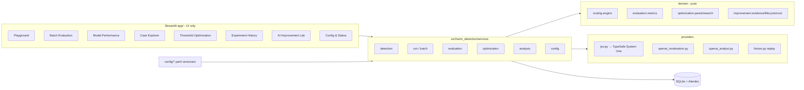

# Social Media Harm Detection Lab

An independent Trust & Safety **detection, evaluation, and experimentation** platform. It classifies English
comments for harassment-related and threatening-harassment signals with **TypeSafe AI Jev**, applies
**deterministic, auditable routing rules** (No Flag / Standard Review / Priority Review), benchmarks the
results against **published human-labeled data** (Civil Comments) and the **OpenAI Moderation API**, and
supports a human-controlled improvement loop (threshold optimization with Pareto analysis, GPT-assisted
error analysis, versioned configuration promotion).

> **Detection is not enforcement.** The lab produces risk signals and review recommendations only. It does not
> take actions on any platform, and proxy benchmark labels are not confirmed X policy violations.
>
> Independent project — **not affiliated with X, TypeSafe AI, or OpenAI.**

## Why it exists

A detector's scores alone don't tell a T&S team how reliably threats are caught, which content causes false
positives, what review volume a threshold implies, or whether a change actually helped. This lab makes those
questions measurable and reproducible: every routing decision can be recomputed from stored signals plus a
versioned configuration, and every change goes through explicit, audited human decisions.

## Scope

In scope (MVP v1): English text; optional parent comment and target context; Jev structured classification;
deterministic three-level routing; interactive and batch detection; Civil Comments ingestion with a stratified
development sample and an untouched random holdout; OpenAI Moderation comparison; category and routing-proxy
metrics with bootstrap CIs; saved versioned runs; threshold search with constraints and a Pareto front; human
selection and holdout evaluation; case explorer; opt-in GPT-5.4 mini error analysis with evidence checks and a
recommendation lifecycle; SQLite persistence; Streamlit dashboards; exports; offline fixtures; restricted
public demo.

Non-goals: live X timelines, posting/reporting/removal, account-level decisions, reviewer queues, incident
severity, non-English or multimodal content, coordination detection, model training, multi-user auth, and any
automatic adoption of AI-suggested changes. A read-only X Home/Following connector is a **Phase 2** item and is
not built.

## Architecture



Dependencies point inward: UI pages call services; services use pure domain modules and provider adapters; no
provider JSON is parsed in UI code. See [docs/architecture.md](docs/architecture.md).

### Model responsibility separation

| Model | Role | Influences routing? |
|---|---|---|
| TypeSafe **Jev** (`jev-latest`, configurable/pinnable) | Primary detector: 4 `noul` probability questions in one request | **Yes** (only source of routing signals) |
| OpenAI **Moderation** (`omni-moderation-latest`) | Independent offline benchmark on the same text-only cohort | No |
| OpenAI **GPT-5.4 mini** | Optional, opt-in error analyst proposing testable changes | No — proposals need human approval, experiment, and promotion |

## Setup

Prerequisites: Python 3.12+, [uv](https://docs.astral.sh/uv/) (or `pip install uv`).

```bash
uv sync
```

```bash
cp .env.example .env
```

Environment variables (`.env`):

| Variable | Default | Purpose |
|---|---|---|
| `APP_MODE` | `local_offline` | `local_live` \| `local_offline` \| `public_demo` |
| `TYPESAFE_API_KEY` | — | Jev access (live mode only) |
| `OPENAI_API_KEY` | — | Moderation benchmark + GPT analysis (live mode only) |
| `JEV_MODEL` | `jev-latest` | Pin e.g. `jev-1.14.0` once validated |
| `OPENAI_MODERATION_MODEL` | `omni-moderation-latest` | |
| `OPENAI_ANALYST_MODEL` | `gpt-5.4-mini` | |
| `DATABASE_URL` | `sqlite:///data/harm_detection.sqlite` | |
| `MAX_ANALYST_BUDGET_USD` | `5.00` | Local spending target (estimate, not a billing cap) |

## Offline demo (no API keys)

```bash
uv run python scripts/bootstrap.py
```

```bash
uv run streamlit run app/main.py
```

`bootstrap.py` runs migrations, seeds the versioned configs, imports 26 **synthetic** fixture cases (it rejects
one deliberate duplicate and one deliberate holdout leak), and replays **synthetic fixture** outputs through the
full pipeline. Fixture values are hand-authored to exercise deterministic behavior; they are labeled as such
everywhere and are **not model outputs**.

## Dataset preparation (Civil Comments)

```bash
uv run python scripts/prepare_dataset.py
```

Downloads the pinned Hugging Face revision of `google/civil_comments` (CC0-1.0; ~60 MB, cached in the
git-ignored `data/raw/`), samples 600 development records (100 threat-enriched, 100 insult-enriched, 50
borderline, 350 representative) from the `validation` split and 400 random holdout records from the `test`
split, checks exact and near-duplicate leakage, writes `data/processed/*.jsonl` plus
`data/manifests/civil_comments_v1.json`, and imports them. See
[docs/evaluation_methodology.md](docs/evaluation_methodology.md).

## Live API configuration

1. Put keys in `.env` (never commit it) and set `APP_MODE=local_live`.
2. Validate contracts with minimal calls:

```bash
uv run python scripts/validate_integrations.py --jev --confirm
```

```bash
uv run python scripts/validate_integrations.py --moderation --analyst --confirm
```

Results are written to `docs/integration_validation.json`.

## Batch evaluation

From the **Batch Evaluation** page (confirmation required before paid calls; resumable; per-case persistence),
or the CLI:

```bash
uv run python scripts/run_benchmark.py --dataset civil_comments --provider jev --cohort development --yes
```

```bash
uv run python scripts/run_benchmark.py --dataset civil_comments --provider moderation --cohort development --yes
```

Resume with `--resume <run_id> --yes`. Offline, `--dataset synthetic_demo` replays fixtures.

## Threshold optimization

**Threshold Optimization** re-routes stored development predictions (no new model calls) over a configurable
grid, applies risk constraints (provisional defaults), marks non-dominated candidates on the (threat-proxy recall
↑, representative review volume ↓) front, and lets you **select a candidate with a written rationale**. The
selection is saved as an immutable, frozen, *inactive* routing config. Then evaluate it once on the holdout
(re-routing stored holdout predictions or a new Jev holdout run). A second holdout evaluation requires explicit
acknowledgement and is labeled **exploratory**. Activation is a separate confirmed action on the Configuration
page.

## AI improvement workflow

In the **AI Improvement Lab**, pick individual errors or an error cluster from a non-holdout run; the page shows
the estimated cost and blocks requests that would exceed the local budget. GPT-5.4 mini returns a
Pydantic-validated structure (observations, hypotheses, recommendations, limitations). Case IDs, rule IDs and
quoted excerpts are verified against the supplied evidence; invalid analyses are rejected visibly.
Recommendations move `proposed → accepted_for_experiment | rejected → experimented → promoted | not_promoted`.
Accepting creates an inactive candidate config, experiments are linked runs, and promotion requires
confirmation. Nothing changes the active detector automatically.

## Public demo

```bash
uv run python scripts/export_public_demo.py
```

```bash
APP_MODE=public_demo uv run streamlit run app/main.py
```

The exporter copies only approved runs (synthetic or CC0 datasets; never playground input; raw provider
responses dropped; no analyses, audit or integration events) into `data/public_demo/public_demo.sqlite`. Public
mode opens it **read-only**, ignores any credentials, disables inference/AI/writes, and keeps threshold
exploration session-local. See [docs/deployment.md](docs/deployment.md).

## Testing

```bash
uv run ruff check . && uv run ruff format --check .
```

```bash
uv run pytest
```

The default suite (unit, contract, integration, Streamlit AppTest UI) needs no credentials and makes no network
calls. Contract tests check the Jev adapter against the documented System One OpenAPI contract with `respx`,
and check the OpenAI adapters against the SDK's own response types.

## Known limitations

See [docs/limitations.md](docs/limitations.md). Key points: proxy labels ≠ policy decisions; the representative
development subset contains **0 threat-proxy positives** and the holdout only **4**, so threat-recall estimates
are highly uncertain; enriched review rates are not platform volume; Jev returns probabilities, not
rationales; single comments lack history/relationship context; local cost controls are estimates.

## Data provenance and licenses

* Civil Comments — `google/civil_comments` @ `f2970eb3a557…`, CC0-1.0 (per dataset card). Original annotation
  fractions are preserved unmodified.
* Synthetic fixtures — authored for this project; labels are synthetic author expectations.
* Policy rubric — paraphrased adaptation inspired by the published X Abuse & Harassment and Violent Content
  policies (links and access dates in `config/policies/harassment_v1.yaml`). Not official X guidance.

## Sample screenshots

Screenshots are not committed. Run the offline demo and open Overview, Model Performance, and Threshold
Optimization to reproduce them.
